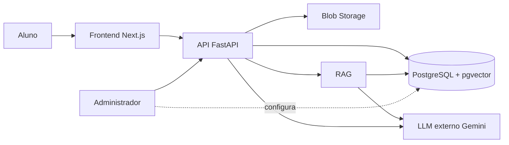

# ExtensionFlow

Assistente institucional de IA para ajudar alunos da Unicesumar a entender,
realizar e obter o deferimento de atividades extensionistas.

[](https://github.com/MatheusSSiqueira/ExtensionFlow-Core/actions/workflows/ci.yml)
[](#licen%C3%A7a)

## Visão geral

O ExtensionFlow oferece uma conta individual para cada aluno. Nela, o aluno
envia os documentos relacionados à sua atividade extensionista e recebe apoio
para entender os requisitos e preparar as evidências necessárias. Um agente
avaliador cruza a descrição da atividade com regras cadastradas pelo
administrador e com o conteúdo dos documentos institucionais recuperados por
RAG.

O problema tratado é a dificuldade de interpretar regulamentos, identificar
quais documentos são necessários e verificar se as evidências apresentadas
atendem aos critérios institucionais antes da submissão.

## Funcionalidades

- **Autenticação por aluno:** cadastro e login com e-mail institucional
  `@unicesumar.edu.br`, senha protegida por hash e token de acesso JWT.
- **Upload de documentos:** envio de um arquivo associado a uma atividade
  extensionista. O conteúdo é extraído, dividido em blocos e indexado para
  busca semântica.
- **Agente RAG:** recuperação dos trechos mais relevantes dos documentos
  ingeridos, usando embeddings gerados pelo Gemini e busca por distância
  cosseno no pgvector.
- **Agente avaliador:** análise estruturada de conformidade com base nas regras
  ativas da atividade e no contexto recuperado. A resposta indica requisitos,
  pendências, justificativa, fontes e status.
- **Regras configuráveis:** o modelo de dados permite que administradores
  mantenham critérios e descrições de avaliação por atividade.
- **Memória persistente por aluno:** o modelo de dados possui
  `conversation_memories`, associada ao aluno, para armazenar o histórico
  persistente de conversas. A integração completa dessa memória com o fluxo do
  agente ainda não está implementada.

## Arquitetura

Componentes principais:

- **API:** FastAPI, responsável pela autenticação, upload, análise de
  conformidade e health check.
- **Banco relacional:** PostgreSQL, acessado com SQLAlchemy assíncrono e
  `asyncpg`.
- **Busca vetorial:** extensão pgvector no PostgreSQL, com embeddings de
  dimensão 768 e índice HNSW.
- **Blob Storage:** camada prevista para armazenar os arquivos enviados. No
  código atual, a função de persistência é um stub que retorna uma URI
  `blob://pending/...`.
- **LLM externo:** Google Gemini, usado para embeddings e para a análise
  estruturada de conformidade.
- **Frontend:** frontend Next.js previsto na arquitetura institucional; neste
  repositório, a API também serve `frontend/index.html` e os arquivos estáticos
  de `frontend/`.



## Stack técnica

O projeto usa Python 3.11 na imagem Docker e as seguintes dependências, com as
versões mínimas ou restrições declaradas em `requirements.txt`:

| Componente | Versão declarada |
| --- | --- |
| FastAPI | `>=0.109.0` |
| python-multipart | `>=0.0.9` |
| Uvicorn | `>=0.27.0` |
| Pydantic | `>=2.5.0` |
| pydantic-settings | `>=2.1.0` |
| google-genai | `>=0.2.0` |
| pypdf | `>=4.0.0` |
| python-docx | `>=1.1.0` |
| python-dotenv | `>=1.0.0` |
| SQLAlchemy | `>=2.0.0` |
| asyncpg | `>=0.29.0` |
| Alembic | `>=1.13.0` |
| passlib[bcrypt] | `>=1.7.4` |
| bcrypt | `<5` |
| PyJWT | `>=2.8.0` |
| psycopg[binary] | `>=3.2.0` |

## Como rodar localmente

### Configuração

Copie `.env.example` para `.env` e preencha a chave do Gemini:

```bash
cp .env.example .env
```

O arquivo de exemplo declara:

| Variável | Finalidade |
| --- | --- |
| `GEMINI_API_KEY` | Chave usada pelo Gemini para geração de conteúdo e embeddings |
| `PROJECT_NAME` | Nome exibido pela API; o padrão do exemplo é `ExtensionFlow API` |

O código também lê `DATABASE_URL` para o PostgreSQL e `JWT_SECRET` para os
tokens de autenticação. Eles não estão declarados em `.env.example`; devem ser
configurados no ambiente antes de executar as migrações e a aplicação. As
configurações `ENVIRONMENT`, `CORS_ALLOWED_ORIGINS`, `GEMINI_MODEL` e
`GEMINI_TEMPERATURE` possuem valores padrão no código.

### Docker Compose

O `docker-compose.yml` define o serviço `api`, constrói a imagem do
`Dockerfile`, expõe a porta `8000` e carrega as variáveis de `.env`:

```bash
docker compose up --build
```

O Compose deste repositório não define um serviço PostgreSQL; portanto, o
`DATABASE_URL` deve apontar para uma instância PostgreSQL disponível.

### Migrações

Com o ambiente configurado, aplique as migrações Alembic:

```bash
alembic upgrade head
```

As migrações criam o esquema inicial, habilitam as políticas de Row-Level
Security para documentos e memórias e criam a extensão/tabela de embeddings
com pgvector.

### Ingestão dos documentos institucionais

Os documentos de `data/raw_docs/` são percorridos recursivamente, têm o texto
extraído, são divididos em blocos e indexados no PostgreSQL com pgvector:

```bash
python -m app.rag.ingest
```

## Como rodar os testes

Instale as dependências de desenvolvimento usadas pelo CI e execute o pytest:

```bash
python -m pip install pytest
python -m pytest
```

## CI/CD

O workflow [`.github/workflows/ci.yml`](.github/workflows/ci.yml) é executado
em cada `push` e `pull_request`. Ele:

1. faz checkout do repositório;
2. configura o Python 3.11 com cache de pip;
3. instala as dependências do projeto, `pytest` e `ruff`;
4. executa os testes com `python -m pytest`;
5. verifica o código com `ruff check .`; e
6. constrói a imagem Docker com a tag `extensionflow-core:ci`.

## Privacidade e LGPD

O projeto contém uma migração que habilita Row-Level Security para
`student_documents` e `conversation_memories`, com políticas baseadas no
identificador do aluno. O isolamento por aluno é, portanto, parte do esquema
de dados, mas a própria migração documenta que a aplicação ainda precisa
definir `app.current_student_id` no início de cada requisição autenticada para
que as políticas sejam aplicadas corretamente.

Estado atual dos controles:

- **Isolamento por aluno via RLS:** parcialmente implementado no banco;
  falta integrar a definição do contexto da sessão em cada requisição.
- **Criptografia em repouso:** **planejado**; não há configuração desse
  controle nos arquivos atuais.
- **Consentimento:** **planejado**; não há campo ou fluxo de consentimento
  implementado no código atual.
- **Exportação de dados:** **planejado**; não há fluxo implementado.
- **Exclusão de dados:** **planejado**; não há fluxo implementado.
- **Armazenamento de arquivos:** **planejado**; o Blob Storage atual é apenas
  um stub (`blob://pending/...`).

## Roadmap

- Integrar de fato o Blob Storage para persistência dos arquivos enviados.
- Concluir a aplicação do contexto de aluno exigido pelas políticas RLS.
- Integrar a memória persistente por aluno ao fluxo de conversas do agente.
- Implementar consentimento, criptografia em repouso, exportação e exclusão
  de dados em conformidade com a LGPD.
- Consolidar o frontend Next.js com a API e os fluxos de aluno e
  administrador.
- Ampliar a cobertura de testes dos fluxos de RAG, ingestão e avaliação.

## Como contribuir

1. Crie uma branch para sua alteração.
2. Faça mudanças pequenas e compatíveis com a arquitetura existente.
3. Atualize a documentação relacionada quando o comportamento mudar.
4. Execute `python -m pytest` e `ruff check .` localmente.
5. Abra um pull request descrevendo o problema, a solução e como validá-la.

## Licença

Não há um arquivo de licença identificado neste repositório. Até que uma
licença seja adicionada pelos responsáveis, os direitos de uso, cópia e
distribuição permanecem indefinidos.
